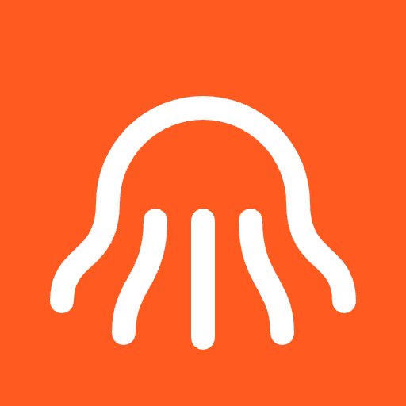

<p align="center">
  
</p>

# Octobot

**Bahasa Indonesia** | [English](README.md)

Robot gurita prosedural yang bisa dikendarai di dasar laut 3D, dibuat dengan Three.js.
Seluruh model dan dunianya dihasilkan lewat kode, tanpa file aset 3D.

Coba langsung di **https://octobot.ahmadarif.id**.

Untuk menjalankan lokal, jalankan `npm install && npm run build`, lalu buka `index.html` di browser tanpa server.

## Kontrol

| Tombol | Aksi |
| --- | --- |
| `W` / `↑` | Maju |
| `S` / `↓` | Mundur |
| `A` `D` / `←` `→` | Belok |
| `Shift` / `Spasi` + maju/mundur | Jet |
| `E` | Urai semua bagian |
| `I` | Nyalakan atau matikan mode AI |
| `F` | Masuk atau keluar layar penuh |
| `M` | Matikan atau nyalakan suara |
| `Esc` | Buka atau tutup menu utama |
| Seret mouse, scroll | Putar kamera, zoom |

Tombol layar penuh ada di bilah atas. iPhone Safari tidak punya Fullscreen API, jadi pakai **Tambah ke Layar Utama** lalu buka dari ikonnya.

Di desktop, kontrol gerak juga tersedia sebagai tombol di layar.

## Gamepad virtual (HP dan tablet)

Muncul otomatis di layar sentuh atau jendela sempit.

| Kontrol | Aksi |
| --- | --- |
| Joystick | Maju, mundur, dan belok secara analog |
| `A` | Jet selama ditahan, langsung meluncur maju walau joystick diam |
| `B` | Urai semua bagian |
| `X` | Buka atau tutup lensa |
| `Y` | Siklus mantel, pompa, lalu tutup |
| `AI` di pojok kanan atas | Nyalakan atau matikan mode AI |

## Bahasa

Tampilan tersedia dalam **English** (bawaan) dan **Bahasa Indonesia**. Pilih di Pengaturan, baik dari menu utama maupun saat bermain. Pilihannya tersimpan.

## Kualitas grafis

Buka ikon pengaturan di bilah atas. Mode **Otomatis** (bawaan) menebak level awal dari perangkat, mengukur FPS sungguhan, lalu menurunkan kualitas saat di bawah 27 FPS dan menaikkannya lagi saat lancar. Bisa juga dikunci ke Tinggi, Sedang, atau Rendah; pilihannya tersimpan.

## Mode online

Permainan selalu dimulai dari menu utama: **Main Sendiri** atau **Main Bersama**. Main Bersama nonaktif selama tidak ada internet atau server tak terjangkau, dan aktif sendiri begitu terjangkau. Menu bisa dibuka kapan saja saat bermain lewat tombol menu di bilah atas, `Esc`, atau tombol Back di Android, jadi mode bisa diganti tanpa menutup game.

Tanpa akun. Server di `server/` memberi nama acak dan menempatkan pemain ke ruang berisi maksimal 20 orang. Dunianya sama untuk semua pemain karena dibuat dari seed tetap, sedangkan robot pemain lain digambar dengan model ringan. Ikon pengaturan menampilkan daftar pemain dan tombol **Susul** untuk pindah ke dekat mereka. Permainan tetap jalan normal saat server tidak terjangkau.

```sh
cd server && npm install && npm test
PORT=3303 npm start                      # lalu buka index.html?ws=ws://127.0.0.1:3303
```

## Penghuni laut

Semua hewan laut juga robot dan bergerak sendiri dengan perilakunya masing-masing: kawanan ikan kecil yang kabur kalau didekati, ikan besar, ikan raksasa, hiu besar yang mengitari dan menyambar lewat, paus, pari manta, penyu, kuda laut, dan ubur-ubur. Gelembung keluar dari ventilasi dasar laut, robot, dan hewan-hewan itu.

Semua suara dibuat dari kode, tanpa file audio dan tanpa musik.

## Mode AI

Robot berjalan sendiri: menjelajah, mendekati objek, memindai sekitar, mundur, meluncur dengan jet, dan berhenti untuk membuka lensa, mantel, pompa, atau mengurai diri. AI memakai kontrol yang sama dengan pemain dan menghindari rintangan sendiri. Menggerakkan robot secara manual langsung mengambil alih kendali.

## Build

```sh
npm install
npm run build   # menghasilkan dist/app.js
npm run dev     # watch + server lokal
npm run deploy  # build lalu deploy ke Cloudflare Workers
npm run android:debug  # build APK di PC build lewat Docker, hasil di release/
```

## Lisensi

Kode terbuka untuk dibaca, di bawah [PolyForm Noncommercial License 1.0.0](LICENSE). Kamu boleh membaca, mempelajari, menjalankan, dan mengubah kode ini untuk keperluan pribadi, pendidikan, riset, dan keperluan nonkomersial lainnya. Pemakaian komersial, termasuk menjual atau menerbitkannya sebagai aplikasi berbayar atau beriklan, tidak diizinkan. Nama dan ikon Octobot tidak termasuk dalam lisensi ini.
