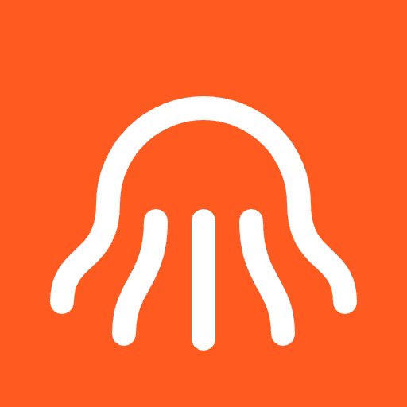

<p align="center">
  
</p>

# Octobot

**English** | [Bahasa Indonesia](README.id.md)

A procedural robot octopus you can drive across a 3D seabed, built with Three.js.
Every model and the whole world are generated in code, with no 3D asset files.

Play it at **https://octobot.ahmadarif.id**.

To run it locally, run `npm install && npm run build`, then open `index.html` in a browser, no server needed.

## Controls

| Key | Action |
| --- | --- |
| `W` / `↑` | Forward |
| `S` / `↓` | Reverse |
| `A` `D` / `←` `→` | Turn |
| `Shift` / `Space` + forward/reverse | Jet |
| `E` | Explode all parts |
| `I` | Toggle AI mode |
| `F` | Enter or leave fullscreen |
| `M` | Mute or unmute |
| `Esc` | Open or close the main menu |
| Drag mouse, scroll | Orbit camera, zoom |

The fullscreen button is in the top bar. iPhone Safari has no Fullscreen API, so use **Add to Home Screen** and open the game from its icon.

On desktop the drive controls are also available as on-screen buttons.

## Virtual gamepad (phones and tablets)

It appears automatically on touch screens or narrow windows.

| Control | Action |
| --- | --- |
| Joystick | Analog forward, reverse and turn |
| `A` | Jet while held, launching forward even with the stick centered |
| `B` | Explode all parts |
| `X` | Open or close the lens |
| `Y` | Cycle mantle, pump, then close |
| `AI` in the top right | Toggle AI mode |

## Language

The interface is available in **English** (default) and **Bahasa Indonesia**. Pick one in Settings, from the main menu or during play. The choice is saved.

## Graphics quality

Open the settings icon in the top bar. **Auto** (default) guesses a starting level from the device, measures the real frame rate, lowers quality below 27 FPS and raises it again when things run smoothly. You can also pin it to High, Medium or Low; the choice is saved.

## Online mode

The game always starts at the main menu: **Play Solo** or **Play Together**. Play Together is disabled while there is no internet or the server is unreachable, and enables itself as soon as it can connect. The menu opens any time during play from the menu button in the top bar, `Esc`, or the Android Back button, so you can switch modes without closing the game.

No accounts. The server in `server/` assigns a random name and places players in rooms of up to 20. The world is identical for everyone because it is built from a fixed seed, while other players' robots are drawn with a lightweight model. The settings icon lists players with a **Catch up** button to jump next to them. The game keeps working normally when the server is unreachable.

```sh
cd server && npm install && npm test
PORT=3303 npm start                      # then open index.html?ws=ws://127.0.0.1:3303
```

## Sea life

All the sea creatures are robots too, and move on their own with their own behavior: small fish schools that scatter when approached, big fish, giant fish, big sharks that circle and swoop past, whales, manta rays, turtles, seahorses and jellyfish. Bubbles rise from seabed vents, the robot and the animals.

Every sound is synthesized in code, with no audio files and no music.

## AI mode

The robot walks on its own: it explores, approaches objects, scans around, reverses, glides with the jet, and stops to open the lens, mantle, pump or take itself apart. The AI uses the same controls as the player and avoids obstacles by itself. Moving the robot manually takes over immediately.

## Build

```sh
npm install
npm run build   # produces dist/app.js
npm run dev     # watch + local server
npm run deploy  # build, then deploy to Cloudflare Workers
npm run android:debug  # build the APK on the build PC through Docker, output in release/
```

## License

Source-available under the [PolyForm Noncommercial License 1.0.0](LICENSE). You may read, study, run and modify the code for personal, educational, research and other noncommercial purposes. Commercial use, including selling it or publishing it as a paid or ad-supported app, is not permitted. The Octobot name and icon are not covered by this license.
